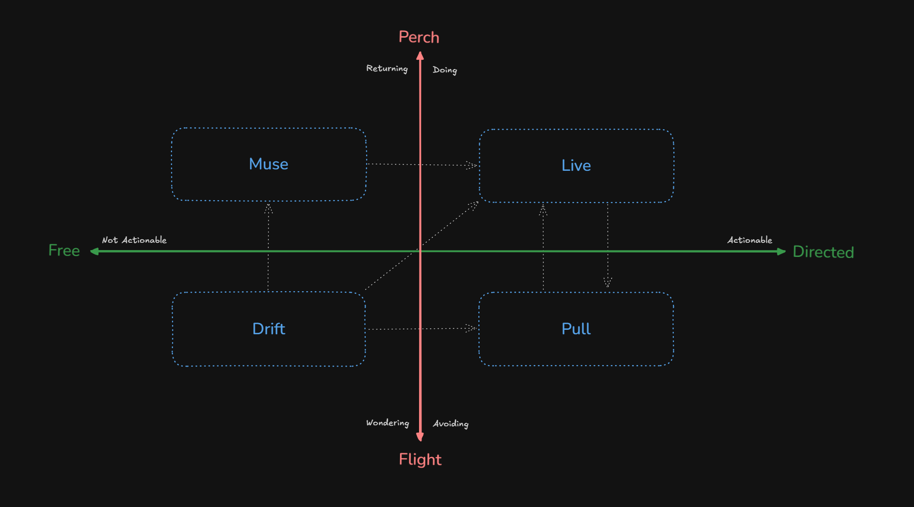

# Stream of Consciousness

A minimalist productivity system for neurodivergent brains.

Core philosophy: externalize the flow without enforcing rigid structure. The system is the flow — it doesn't try to *organize* your brain, it works *with* it. No fixed state, no concept of project, to-do, or done. Items flow in, decay over time, and either get resolved or restreamed. Continuity by design, embraced impermanence.

Designed for brains that don't do well with traditional task management.

## How it works

Everything in the stream has a **type** and a **decay period**. Type is a *motion-state* — it classifies what your attention is *doing* with an item, not what it's about. From William James's "flights and perchings": two are **perches** (attention landed and resting) and two are **flights** (the movement between), crossed with directed-vs-free:



| Type | In a word | Decay | What it is |
|------|-----------|-------|------------|
| live | doing | 7 days | Directed perch — a foot is already down, you're working on it now. *Would I act on it today?* |
| pull | avoiding | 4 days | Directed flight — a known action you keep not starting. You know the next step; you just haven't. Shortest by design: resolve or reveal, fast. |
| muse | returning | 21 days | Free perch — no action, but you keep coming back to sit with it because it keeps giving. Longest: it's allowed to persist. |
| drift | wondering | 5 days | Free flight — interesting with no landing in sight; ask "so what would you do?" and you'd shrug. Fading is the feature — what matters resurfaces on its own. |

Items don't get "done" — they **leave the stream** (resolved) or get **restreamed** (redefined). Decay forces regular triage without guilt. If something decays and you don't care, it was never important. If you do care, restream it.

### The hook — an engagement signal

Separately from its type, an item can carry a **hook**: a four-state read of *what could actually get you to engage it* (grounded in Dr. William Dodson's interest-based nervous system). It's a signal, not a per-item chore — most items leave it unset.

| Hook | Meaning |
|------|---------|
| *(unset)* | Undecided — not triaged |
| interest | Has an in-the-moment hook: interesting, challenging, or novel now |
| passion | Tied to something deeper and lasting — where durable energy lives |
| none | Explicitly no hook — at risk; needs one or should be dropped |

Setting a hook — or adjusting a deadline — is a lightweight update that does **not** reset the item's decay clock. Urgency isn't a hook; it's carried by the deadline and decay.

## Quickstart — pick your path

| Path | Best for | Where it runs | Where your data lives | Setup |
|---|---|---|---|---|
| **A. Local file** | You work in Claude Code, no mobile sync needed | local stdio (Claude Code only) | a JSON file at `~/.stream-of-consciousness` | ~1 min |
| **B. Local + Todoist** | Claude Code + you want items on your phone via Todoist's app | local stdio (Claude Code only) | your Todoist account | ~5 min |
| **C. Remote MCP** | You want the stream in Claude.ai (web, desktop, mobile) | Cloudflare Workers (yours) | your Todoist account | ~15 min — see [docs/cloudflare-deploy.md](docs/cloudflare-deploy.md) |

**B and C share the same Todoist account, so they share the same stream.** Use both at once if you want.

---

## Path A — local file

Install as a Claude Code plugin:

```
/plugin marketplace add onebit0fme/stream-of-consciousness
/plugin install stream-of-consciousness
```

That's it. Your stream lives at `~/.stream-of-consciousness`. The plugin auto-installs the slash commands and the background skill.

## Path B — local + Todoist sync

Same plugin install as Path A, then set two environment variables for your Claude Code MCP config (`~/.claude/settings.json`):

```json
{
  "mcpServers": {
    "stream": {
      "command": "npx",
      "args": ["-y", "stream-of-consciousness"],
      "env": {
        "STREAM_BACKEND": "todoist",
        "TODOIST_API_TOKEN": "<your-token>",
        "TODOIST_PROJECT_ID": "<optional-project-id>"
      }
    }
  }
}
```

Get your token from <https://todoist.com/help/articles/find-your-api-token-Jpzx9IIlB>. Optionally scope the stream to a specific project — strongly recommended for a clean experience (see [Project scoping](#project-scoping) below). Restart Claude Code.

Items now live in Todoist. They appear in Todoist's mobile and web apps. Items you add directly in Todoist are automatically picked up by the stream.

## Path C — remote MCP (Claude.ai connector)

Deploy your own remote MCP server to Cloudflare Workers, then add it to Claude.ai as a custom connector. Each user (you, and anyone you share it with) signs in with their own Todoist account via OAuth.

This is power-user territory — see **[docs/cloudflare-deploy.md](docs/cloudflare-deploy.md)** for the full walk-through.

---

## Backends

### File (Path A)

Your stream lives at `~/.stream-of-consciousness`. A single JSON file, created automatically on first use. No configuration needed.

### Todoist (Paths B + C)

Uses the Todoist API as the full backend — items live in Todoist, visible everywhere Todoist is.

For Path B (stdio):

| Variable | Required | Description |
|----------|----------|-------------|
| `STREAM_BACKEND` | Yes | Set to `"todoist"` |
| `TODOIST_API_TOKEN` | Yes | Your [Todoist API token](https://todoist.com/help/articles/find-your-api-token-Jpzx9IIlB) |
| `TODOIST_PROJECT_ID` | No | Scope items to a specific project |

For Path C, OAuth handles credentials; project selection happens via the picker page during first connect.

#### Project scoping

When a project ID is set (Path B env var, or Path C picker), the stream is bound to that project — all reads and writes are scoped to it. For Path B without a project ID, reads pull from all projects across your account, while new items go to Inbox. **Setting a project is strongly recommended for a clean, predictable stream.**

#### How it maps to Todoist

| Stream concept | Todoist field |
|---------------|---------------|
| type / motion-state (live/pull/muse/drift) | section: `Live` / `Pull` / `Muse` — `drift` has no section (sections auto-created on demand) |
| hook (engagement signal) | priority: unset → p4 (default) · interest → p3 · passion → p2 · none → p1 |
| content | content + description (auto-split at first newline; 500-char title limit handled with a sentinel) |
| comments | folded into content (oldest first); carried into the body on restream |
| start date | due date (future only) |
| deadline | deadline |
| item ID | short unique suffix of Todoist task ID |

**Date handling:** Items with a future start date get a Todoist due date so they stay out of the stream until that date arrives. Items entering the stream today (or with a past start date) have no due date set — this avoids cluttering Todoist with "overdue" markers. Any existing due dates that have reached today are automatically cleared when the stream is read.

Items added directly in Todoist (e.g., from mobile) are automatically picked up. The task's **section** determines its type (`Live`/`Pull`/`Muse`; no section = `drift`), and its **priority** flag carries the engagement hook (p4/default = unset, p3 = interest, p2 = passion, p1 = none). **Comments** on a task (e.g. notes jotted from mobile) are folded into its content, oldest first, and become part of the item's body when it's restreamed. Restreaming adds a comment on the new task linking back to the original.

## Skills

Skills teach Claude how to interact with the stream — when to add, when to resolve, when to restream, how to triage, what tone to use. There are no slash commands; just describe what you want or share what's on your mind and Claude acts.

**Path A + B (Claude Code plugin):** the plugin auto-installs a background skill that activates whenever you discuss tasks, todos, productivity, or what's on your mind.

**Path C (Claude.ai connector):** add the skill manually. Your deployed worker serves it at `https://<your-worker-domain>/skill.md` — copy that into your Claude.ai project as a skill.

Both paths use the exact same skill file (`plugins/stream-of-consciousness/skills/stream/SKILL.md`) — same philosophy, same tone, same operations, single source of truth.

## MCP tools

The server exposes four tools — same surface on every path:

| Tool | Description |
|------|-------------|
| `stream_add` | Add a new item (content, type, startDate, deadline, hook) |
| `stream_resolve` | Resolve an item by ID |
| `stream_query` | Query items with filters (text search, type, status, decay range, deadline proximity) |
| `stream_restream` | Resolve an item and create a new version of it — an atomic re-encoding |
| `stream_update` | Set an item's hook and/or deadline in place — no decay reset, no new version |

## Development

```bash
git clone https://github.com/onebit0fme/stream-of-consciousness.git
cd stream-of-consciousness
npm install
npm run build
npm test
```

To test the Todoist backend locally over stdio, create a `.env` file with your token and run:

```bash
source .env && STREAM_BACKEND=todoist node build/index.js
```

To work on the Worker:

```bash
npm run worker:dev        # local dev server on :8788
npm run worker:typecheck  # typecheck only
npm run worker:deploy     # deploy to Cloudflare
```

## Project structure

```
├── src/
│   ├── index.ts              — stdio MCP server entry
│   ├── tools.ts              — tool definitions (shared by stdio + worker)
│   ├── types.ts              — types and constants
│   ├── utils.ts              — date math, decay, short IDs
│   ├── backend.ts            — StreamBackend interface
│   ├── backend-factory.ts    — env-driven backend selection (stdio only)
│   ├── file-backend.ts       — file storage backend
│   ├── todoist-backend.ts    — Todoist API backend (shared)
│   └── worker/               — Cloudflare Worker (Path C)
│       ├── index.ts          — OAuthProvider wiring (worker entry)
│       ├── mcp-agent.ts      — StreamMCP Durable Object
│       ├── todoist-handler.ts— Hono routes (OAuth proxy + project picker)
│       ├── todoist-oauth.ts  — Todoist token exchange + refresh
│       ├── todoist-api.ts    — user info fetch
│       ├── todoist-rest.ts   — direct-fetch project list/create
│       ├── project-picker.ts — project selection HTML
│       ├── refreshing-backend.ts — TodoistBackend wrapper w/ token refresh
│       ├── token-store.ts    — KV-backed Todoist credentials + pending auth
│       ├── consent.ts        — consent dialog + CSRF/state helpers
│       └── types.ts          — Env + Props
├── plugins/
│   └── stream-of-consciousness/
│       ├── plugin.json       — plugin manifest
│       ├── .mcp.json         — MCP server config
│       └── skills/stream/    — background skill (Path A + B)
├── .claude-plugin/
│   └── marketplace.json      — marketplace catalog
├── docs/
│   └── cloudflare-deploy.md  — Path C deploy walk-through
├── wrangler.jsonc            — Cloudflare Workers deploy config
├── package.json
├── tsconfig.json             — stdio build
└── tsconfig.worker.json      — worker typecheck
```

## License

MIT
